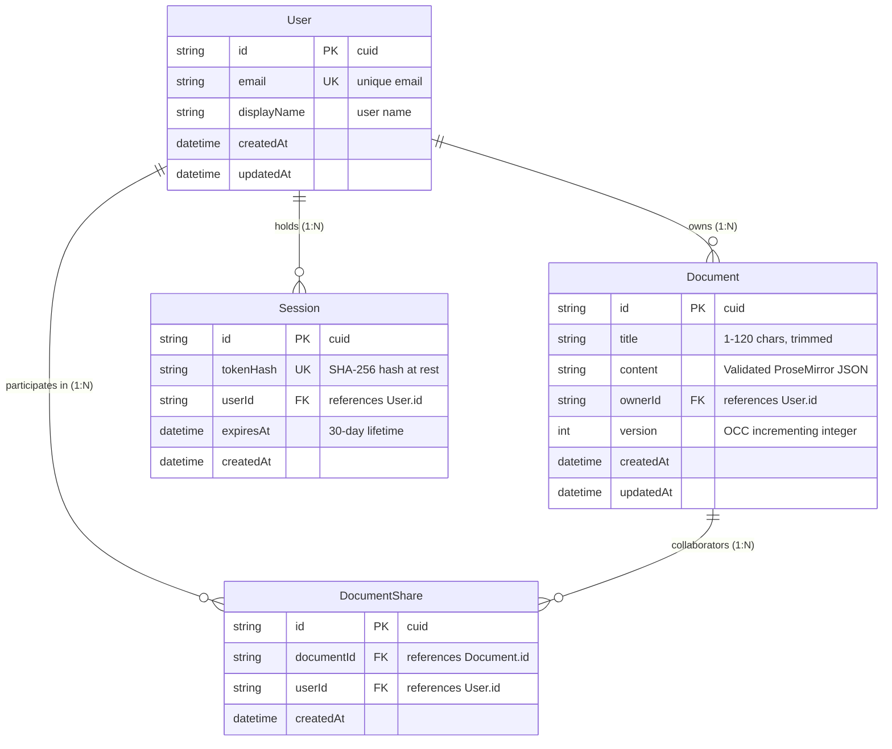

# DraftSpace — Architectural & Technical Design Document

## 1. System Architecture & Responsibility Boundaries

DraftSpace is implemented as a cohesive npm workspace monorepo divided into three distinct layers:

```mermaid
graph TD
    subgraph Client ["Frontend Client (React 18 + Vite + Tailwind + Tiptap)"]
        UI[Workspace Header, Dashboard, Modals]
        ED[Tiptap Rich-Text Editor Canvas]
        SE[Serialized Autosave Engine & Concurrency Handler]
        AUTH_C[Demo Auth Context & Session Token Storage]
        API_C[Typed API Client (Fetch + Credentials: include)]
    end

    subgraph API ["Backend API Server (Node.js + Express + TypeScript)"]
        PROXY[Trust Proxy & Header Sanitization]
        CSRF[CSRF Origin Verification Middleware]
        AUTH_S[Authentication Middleware (Session Token Verification)]
        VAL[AST & JSON Schema Content Validator]
        DOC_C[Document Controller (Atomic OCC & RBAC)]
        DEMO_C[Demo Session Controller]
        STATIC[Static SPA File Server & Protected Fallback]
    end

    subgraph DB ["Database Layer (Prisma ORM)"]
        PRISMA[Prisma ORM Client]
        STORE[(PostgreSQL / SQLite Storage)]
    end

    UI --> ED
    ED --> SE
    SE --> API_C
    AUTH_C --> API_C
    API_C -- "HTTPS / Cookie + Bearer" --> PROXY
    PROXY --> CSRF
    CSRF --> AUTH_S
    AUTH_S --> VAL
    VAL --> DOC_C
    AUTH_S --> DEMO_C
    DOC_C --> PRISMA
    DEMO_C --> PRISMA
    PRISMA --> STORE
    STATIC -. "Serves client/dist" .-> UI
```

### Component Responsibilities:
- **Client (Frontend)**:
  - Maintains responsive document workspace (360px mobile to 4K desktop).
  - Renders the Tiptap ProseMirror canvas with typography, comfortable line length, and custom formatting toolbar.
  - Manages optimistic state, debounced autosave (800ms), and in-flight request serialization.
  - Catches HTTP 409 Concurrency Conflicts and HTTP 403 Revocations, preserving the user's uncommitted text in memory without cursor jumps or silent data loss.
- **API (Backend)**:
  - Resolves user identity strictly from server-issued session tokens (stored hashed at rest). Rejects body spoofing (`ownerId`, `userId`, `role` in payloads).
  - Enforces Role-Based Access Control (RBAC): Owners have exclusive rights to rename titles, manage shares, and delete documents. Collaborators are restricted to content edits.
  - Implements atomic Optimistic Concurrency Control (OCC) using database version incrementing.
  - Validates ProseMirror JSON AST to guarantee that only whitelisted node types and formatting marks are accepted.
  - Serves pre-compiled frontend static assets and implements protected SPA fallback routing.
- **Database (Prisma ORM)**:
  - Relational schema enforcing foreign key cascades, non-null constraints, and unique indices (e.g. `@@unique([documentId, userId])`).
  - Supports PostgreSQL for production deployment and SQLite for zero-dependency local development and automated testing.

---

## 2. Relational Data Model & Access Graph



### Key Data Invariants & Cascade Rules:
1. **Ownership**: Every document has exactly one `ownerId`. The creator at `POST /api/documents` is always resolved as the owner.
2. **Collaborator Uniqueness**: `DocumentShare` enforces `@@unique([documentId, userId])`. Duplicate sharing requests execute an idempotent upsert, preventing duplicate rows or multiple grants.
3. **Cascading Deletion**: Deleting a document automatically cascades and deletes all associated `DocumentShare` rows. Deleting a user cascades and deletes all owned documents and active sessions.

---

## 3. Server-Issued Demo Sessions & Authentication Flow

1. **Mocked Demo Authentication**: To eliminate reviewer friction without sacrificing security, demo personas (**Alice**, **Bob**, **Charlie**) are pre-seeded in the database.
2. **Token Generation**: Selecting an account dispatches `POST /api/demo-session` with the chosen `userId`. The server generates a cryptographically secure 64-character random hex token (`crypto.randomBytes(32)`).
3. **Hashing at Rest**: The server computes the SHA-256 hash of the token (`crypto.createHash('sha256')`) and stores only the hash in the `sessions` table. Raw tokens are never stored at rest.
4. **Transport**: The raw token is returned to the client and simultaneously set as an `HttpOnly`, `SameSite=Lax`, `Path=/` session cookie (`draftspace_session`). In production environments (`NODE_ENV=production`), the `secure: true` flag is enforced.
5. **Request-Time Identity Resolution**: On protected requests (`/api/documents/*`), `authMiddleware` reads the cookie or `Authorization: Bearer <token>` header, hashes the incoming token, and verifies it against the `sessions` table. If valid and not expired, `req.user` is populated. Body spoofing is impossible.

---

## 4. Backend Permission Enforcement (RBAC)

All permission checks are evaluated on the server on every request:

| Operation | Endpoint | Owner | Shared Editor | Unshared User |
|---|---|:---:|:---:|:---:|
| **Read Document** | `GET /api/documents/:id` | ✅ Allowed | ✅ Allowed | ❌ 403 Forbidden |
| **Edit Content** | `PATCH /api/documents/:id` | ✅ Allowed | ✅ Allowed | ❌ 403 Forbidden |
| **Rename Title** | `PATCH /api/documents/:id` | ✅ Allowed | ❌ 403 FORBIDDEN_RENAME | ❌ 403 Forbidden |
| **Mixed Update (Title + Content)** | `PATCH /api/documents/:id` | ✅ Allowed | ❌ 403 (Atomic Rejection) | ❌ 403 Forbidden |
| **List Collaborators** | `GET /api/documents/:id/shares` | ✅ Allowed | ❌ 403 Forbidden | ❌ 403 Forbidden |
| **Grant Collaborator Access** | `POST /api/documents/:id/shares` | ✅ Allowed | ❌ 403 Forbidden | ❌ 403 Forbidden |
| **Revoke Access** | `DELETE /api/documents/:id/shares/:userId` | ✅ Allowed | ❌ 403 Forbidden | ❌ 403 Forbidden |
| **Delete Document** | `DELETE /api/documents/:id` | ✅ Allowed | ❌ 403 Forbidden | ❌ 403 Forbidden |

### Atomic Rejection of Mixed Updates:
If a shared collaborator sends a payload modifying both `content` and `title`, the controller validates role authorization **before** applying any mutation. The entire request is rejected atomically with HTTP 403 (`FORBIDDEN_RENAME`); content is not updated and the version is not incremented.

---

## 5. Editor JSON Persistence & ProseMirror AST Validation

DraftSpace avoids storing raw HTML strings or unvalidated text blobs. Document content is stored as serialized ProseMirror JSON AST.

### Recursive Node & Mark Validation (`editorValidator.ts`):
Before persisting any content update to the database, the backend parses the JSON string and recursively verifies every node against a strict schema:
- **Allowed Top-Level Node**: `doc`.
- **Allowed Block Nodes**: `paragraph`, `heading` (attrs: `level` 1–3), `bulletList`, `orderedList` (attrs: `start`), `listItem`, `blockquote`, `codeBlock` (attrs: `language`).
- **Allowed Inline Nodes**: `text`.
- **Allowed Formatting Marks**: `bold`, `italic`, `underline`.
- **Sanitization**: Any unexpected node type (e.g. `script`, `iframe`, `object`, `applet`) or unknown mark immediately fails validation with HTTP 400 (`INVALID_CONTENT`), neutralizing XSS injection attempts at the API boundary.

---

## 6. Autosave Request Serialization & Caret Preservation

A frequent pitfall in rich-text web editors is cursor jumping or loss of keystrokes during background saves. DraftSpace resolves this with a serialized state machine:

```mermaid
stateDiagram-v2
    [*] --> Idle: Document Loaded
    Idle --> Unsaved: Keystroke Typed (editRevision++)
    Unsaved --> Unsaved: Keystrokes continue (Debounce reset to 800ms)
    Unsaved --> Saving: Debounce timer expires
    
    state Saving {
        [*] --> InFlight: Dispatch PATCH (with revisionAtSaveStart)
        InFlight --> NewerEditsTyped: User types while PATCH is in flight
        NewerEditsTyped --> InFlight: editRevision++
    }
    
    InFlight --> Saved: PATCH 200 OK (editRevision == revisionAtSaveStart)
    InFlight --> ReSave: PATCH 200 OK (editRevision > revisionAtSaveStart)
    ReSave --> Saving: Immediately queue next PATCH with latest version
    
    InFlight --> Conflict: PATCH 409 Conflict (Stale Version)
    Conflict --> Idle: User resolves via ConflictModal
    
    InFlight --> Revoked: PATCH 403 Forbidden (Access Denied)
    Revoked --> Idle: Halt autosave; preserve draft in RevokedAccessModal
```



### Caret Preservation Mechanism:
- In React, calling `editor.commands.setContent()` resets the ProseMirror selection to position 0 (the beginning of the document).
- DraftSpace ensures `editor.commands.setContent()` is called **only** when navigating to a new document or when explicitly reloading from the server during conflict recovery.
- When an autosave request succeeds, the client updates the local document version (`versionRef.current = newVersion`) without re-setting editor content, preserving the user's active cursor position and selection.

---

## 7. Atomic Optimistic Concurrency Control (OCC)

DraftSpace implements database-level Optimistic Concurrency Control using an incrementing integer `version` field.

### Concurrency Sequence:
1. Client fetches Document with `version = N`.
2. Client sends `PATCH /api/documents/:id` with `{ version: N, content: "..." }`.
3. Server executes atomic Prisma update:
   ```typescript
   const updated = await prisma.document.update({
     where: { id, version: clientVersion },
     data: {
       content: newContentJson,
       version: { increment: 1 }
     }
   });
   ```
4. If another session updated the document in the interim, `version` in the database is already `N + 1`. The `where` clause fails to match, Prisma throws error `P2025`, and the server returns `409 CONCURRENCY_CONFLICT` with `currentVersion: N + 1`.
5. The client catches the 409, sets `saveStatus = 'conflict'`, and displays the `ConflictModal`. The user can:
   - **Overwrite with My Draft**: Fetches the newest version and applies the local draft with the incremented version.
   - **Reload Server Version**: Discards the local draft and reloads the current server content.
   - **Copy Draft**: Copies local text to clipboard for safety.

---

## 8. File Upload Validation & Deliberate Scope

### Deliberate Scope Decision:
To guarantee absolute conversion fidelity, security, and performance, file import is **deliberately scoped to UTF-8 `.txt` only (<= 1 MiB)**. Markdown and DOCX are explicitly rejected.

### Ingestion Pipeline (`documentController.ts` & `editorValidator.ts`):
1. **Multer Transport**: Handled in memory (`multer.memoryStorage()`) with a strict `1,048,576` byte (1 MiB) raw file limit. No temporary files are written to disk.
2. **Extension Check**: Filename is checked case-insensitively for `.txt`. Other extensions are rejected with `400 UNSUPPORTED_FILE_TYPE`.
3. **Zero-Byte Check**: Empty buffers are rejected with `400 EMPTY_FILE`.
4. **Binary Content Check**: Buffer is inspected for null bytes (`0x00`). If detected, rejected with `400 BINARY_FILE_REJECTED`.
5. **UTF-8 Fatal Decoding**: Decoded using `new TextDecoder('utf-8', { fatal: true })`. Any malformed byte sequences are rejected with `400 MALFORMED_UTF8`.
6. **BOM Normalization**: UTF-8 BOM (`\uFEFF`) is detected and stripped.
7. **ProseMirror AST Generation & Limit Alignment**: Text is split by newlines into paragraphs. Consecutive empty lines produce empty paragraphs. Script tags (e.g. `<script>alert(1)</script>`) are placed into plain text nodes, rendering them inert. To accommodate the ProseMirror JSON AST boilerplate (~60 bytes per paragraph node) and quote/backslash escaping overhead on 1 MiB files, the serialized editor content limit is aligned to a finite, documented `20 MiB` (`20 * 1024 * 1024` bytes), and Express body-parser limit to `25mb`. Both import and subsequent document edits/saves (`PATCH /api/documents/:id`) share identical validation rules.
8. **Document Creation**: Saved as a new document owned by the active user with a safe derived title (clamped to 120 chars).

---

## 9. Deployment Architecture

DraftSpace is configured for zero-friction single-origin deployment:

- **Unified Single Origin**: The Express server serves both API routes (`/api/*`) and pre-compiled client assets (`client/dist`). This eliminates CORS preflight latency, third-party cookie restrictions, and separate origin costs.
- **Reverse Proxy Support**: `app.set('trust proxy', 1)` enables accurate HTTPS and secure cookie detection behind Render, Railway, Fly.io, or Cloudflare.
- **SPA Fallback Routing**: Clean URLs and deep links (such as `/?doc=<id>`) serve `index.html`. Asset requests containing extensions (`*.js`, `*.css`) return HTTP 404 JSON when missing, preventing script execution errors.
- **Infrastructure as Code**:
  - `render.yaml`: Provisions a web service + managed PostgreSQL database.
  - `Dockerfile`: Multi-stage Alpine Linux container.
  - `docker-compose.yml`: Local/remote stack pairing DraftSpace with PostgreSQL 16.
  - `railway.toml`: Automated Nixpacks build and deploy configuration.

---

## 10. Scope Prioritization Rationale

During development, architectural effort was deliberately concentrated on:
1. **Data Integrity & Concurrency**: Preventing silent overwrites through atomic OCC and serialized autosaves rather than attempting fragile, half-working real-time websockets.
2. **Server-Side Security**: Verifying all permissions, title renames, share grants, and AST nodes on the server rather than trusting client-side logic.
3. **Operational Robustness**: Implementing database migrations, non-destructive idempotent seeds, and clean single-origin deployment manifests.

---

## 11. Concrete Next Steps (2–4 Hour Roadmap)

If allocated an additional 2–4 hours of development time, the recommended prioritized tasks are:

1. **Presence Awareness & Active Collaborator Avatars (1 hour)**:
   - Implement a lightweight heartbeat endpoint (`POST /api/documents/:id/presence`) pinged every 10 seconds.
   - Display collaborator avatars in the header showing who currently has the document open.
2. **Document Export Functionality (45 minutes)**:
   - Add an **Export** button in the editor toolbar supporting download as `.txt` or `.html` (with formatted CSS).
3. **Revision History / Audit Log (1 hour)**:
   - Create a `DocumentRevision` table recording snapshots on manual save or every 10 autosave versions.
   - Add a "Version History" drawer allowing users to review and restore prior versions.
4. **Interactive Comment Threads (45 minutes)**:
   - Add inline text selection comments using ProseMirror decorations and a `Comment` model associated with the document.
