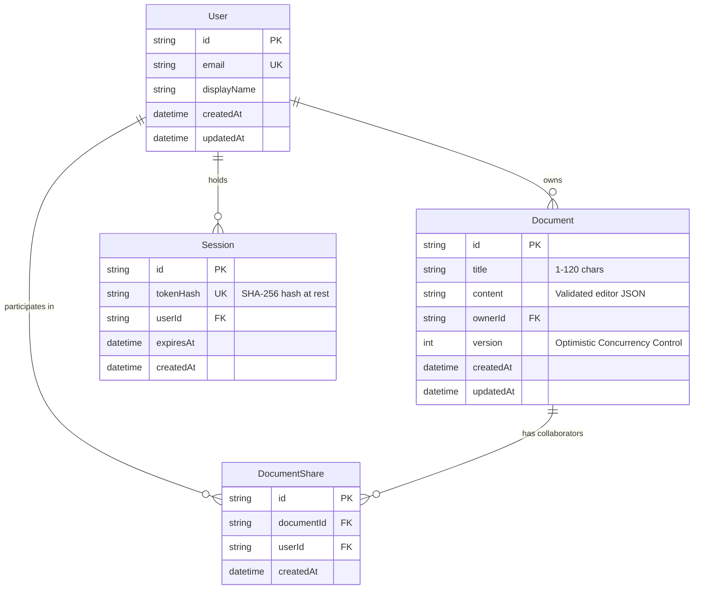

# DraftSpace — Architecture & Technical Design Note

---

## 1. System Architecture

DraftSpace is architected as an npm workspace monorepo comprising a React 18 TypeScript frontend and an Express 4.22 TypeScript backend persisted via Prisma ORM:

```mermaid
graph TD
    subgraph Client ["Client (React + Vite + Tailwind + Tiptap)"]
        UI[Navbar / Dashboard / Editor UI]
        AC[AuthContext & Demo Account Chooser]
        API_C[Typed API Client (credentials: include)]
        TTE[Tiptap Editor Engine (JSON Doc)]
        AS[Debounced Auto-Save with Version Tracking]
    end

    subgraph Server ["Server (Node.js + Express + TypeScript)"]
        CSRF[CSRF Origin Check Middleware]
        AUTH[Auth Middleware (HttpOnly Cookie & Bearer Token)]
        VAL[Editor JSON & Schema Validator]
        DC_S[DocumentController (Optimistic OCC)]
        DSC[DemoSessionController]
        EH[Central Error Handler]
    end

    subgraph Database ["Persistence Layer (Prisma ORM)"]
        PRISMA[Prisma Client]
        DB[(PostgreSQL / SQLite)]
    end

    UI --> TTE
    TTE --> AS
    AS --> API_C
    UI --> API_C
    AC --> API_C

    API_C -- "REST / Cookie & JSON" --> CSRF
    CSRF --> AUTH
    AUTH --> VAL
    VAL --> DC_S
    AUTH --> DSC
    DC_S --> PRISMA
    DSC --> PRISMA
    PRISMA --> DB
```

---

## 2. Relational Data Model (Prisma ORM)



### Unique Constraints & Cascades
- `DocumentShare`: `@@unique([documentId, userId])` guarantees at the database level that duplicate share rows can never exist.
- Cascades: Deleting a document automatically cascades and removes all associated shares. Deleting a user cascades and removes their sessions and owned documents.

---

## 3. Demo Identity & Session Security

1. **Explicit Demo Account Chooser**:
   - Seeded with **Alice Smith** (`user_alice`), **Bob Jones** (`user_bob`), and **Charlie Brown** (`user_charlie`).
   - Selecting a demo persona calls `POST /api/demo-session`.
   - The backend generates a cryptographically secure 64-hex-character token (`crypto.randomBytes(32)`).
   - The server stores the **SHA-256 hash** of the token at rest in the `Session` table.
   - The server sets a secure `HttpOnly`, `SameSite: 'lax'`, path `/` cookie named `draftspace_session` with a 30-day expiry.
2. **Identity Resolution**:
   - Every protected request resolves identity strictly from the verified session (cookie or `Authorization: Bearer <token>`).
   - The server **strictly ignores** any caller-supplied `ownerId`, `actingUserId`, or `role` in request bodies.
3. **CSRF & Origin Verification**:
   - `originCheckMiddleware` validates `Origin` headers on state-changing requests (`POST`, `PATCH`, `PUT`, `DELETE`) against trusted hosts.
4. **Session Expiry & Logout**:
   - Expired sessions are automatically rejected and pruned.
   - `DELETE /api/session` revokes the session in the database and clears the HttpOnly cookie.

---

## 4. Concurrent Saves & Optimistic Concurrency Control (OCC)

To prevent lost updates when multiple sessions edit simultaneously without real-time multi-cursor operational transformation complexity:
1. Every `Document` has an integer `version` initialized to `1`.
2. Every `GET /api/documents/:id` response returns the document along with its current `version`.
3. State-changing updates via `PATCH /api/documents/:id` **must include** the integer `version` loaded by the client:
   ```json
   {
     "version": 2,
     "title": "Updated Title",
     "content": { "type": "doc", "content": [...] }
   }
   ```
4. **Atomic Version Verification**:
   - If the database `version` matches the incoming `version`:
     - The document is updated.
     - The `version` is atomically incremented by 1.
     - Returns `{ document, version: 3, role }`.
   - If the database `version` does not match:
     - The update is rejected with `409 Conflict`.
     - Returns `{ error: "Document version conflict...", code: "CONCURRENCY_CONFLICT", currentVersion }`.
     - The newer server content is **never silently overwritten**.

---

## 5. Strict Role-Based Access Control (RBAC)

The backend enforces strict access control:
- **Owner**: Read, edit content, rename title, list shares, grant access, revoke access, delete.
- **Shared Editor**: Read and edit content.
- **Unshared User**: Cannot read, edit, rename, or share.
- **Owner-Only Renames**:
  - Only the document owner can rename document titles.
  - If a shared editor attempts to rename a document (even in a mixed update containing content), the request is **rejected atomically with HTTP 403 Forbidden** (`code: "FORBIDDEN_RENAME"`).
- **List Isolation**:
  - `GET /api/documents` queries only documents owned by the active user or shared with the active user. Unshared private documents are never included in list responses.

---

## 6. Rich-Text Editor JSON Schema Validation

Rather than storing unverified strings or raw HTML, DraftSpace stores rich text as validated ProseMirror/Tiptap AST JSON.

The backend schema validator (`server/src/utils/editorValidator.ts`) enforces:
1. **Root Requirement**: Must be an object with `type: "doc"`.
2. **Allowed Node Types**: `doc`, `paragraph`, `heading` (levels 1..3), `bulletList`, `orderedList`, `listItem`, `blockquote`, `codeBlock`, `horizontalRule`, `text`.
3. **Allowed Marks**: `bold`, `italic`, `underline`, `code`.
4. **XSS & Unsupported Structure Rejection**:
   - Any unknown node (e.g. `rawHtml`, `script`, `iframe`, `customWidget`) is rejected with HTTP 400 (`code: "INVALID_CONTENT"`).
5. **Payload Limits**: Max payload text length enforced to prevent memory exhaustion attacks.

---

## 7. Product-Relevant File Import Pipeline

`POST /api/documents/import` accepts UTF-8 `.txt` and `.md` files via multipart upload:
1. Validates file size (≤ 2MB) and extensions (`.txt`, `.md`).
2. Converts raw text lines, markdown headings (`#`, `##`, `###`), and lists (`-`, `1.`) into a valid Tiptap ProseMirror document JSON structure.
3. Derives document title from the filename (trimmed, 1–120 characters).
4. Persists the document in the database owned by the active user with initial `version = 1`.

---

## 8. Frontend Architecture, Save Engine & Concurrency Recovery

### Serialized Save Engine & Revision Tracking
1. **Debounce & Concurrency Mutex**:
   - Edits are debounced by 800ms to minimize network traffic while maintaining responsive persistence.
   - `isSavingRef` acts as a concurrency mutex: if a save is in-flight, subsequent edits are flagged dirty (`hasPendingEditsRef = true`) rather than firing overlapping network writes against the same version.
2. **Revision Tracking**:
   - `editRevisionRef` increments on every keystroke.
   - When an in-flight save completes, if `editRevisionRef > revisionAtSaveStart`, the state remains `unsaved` and schedules an immediate follow-up save against the newly acknowledged server version.
3. **Caret Position Preservation**:
   - `TiptapEditor.tsx` isolates `editor.commands.setContent()` strictly to `documentId` transitions.
   - Normal autosaves update the local document metadata and version number in React state without calling `setContent()`, completely preventing caret jumps to position 0 during typing.

### 409 Conflict Recovery Flow
1. If a concurrent save returns HTTP 409, the client transitions `saveStatus` to `'conflict'`.
2. Autosave is stopped immediately, and the local draft is preserved in memory.
3. The `ConflictModal` provides three explicit recovery paths:
   - **Copy Local Draft**: Copies local JSON/text to the clipboard for manual merge safety.
   - **Reload Server Version**: Discards the conflicting draft and pulls the latest acknowledged server content.
   - **Force Overwrite**: Explicitly sends the draft with the newly reported server version (`conflictServerVersion`).

### Navigation & Unsaved Changes Guard
- In-app document switches trigger `attemptNavigation()`: if dirty edits exist, an accessible warning dialog prompts the user to either **Save & Proceed**, **Discard Changes & Leave**, or **Stay Here**.
- Tab closing or browser reloads trigger `window.beforeunload` warning prompts when unsaved edits are dirty.
- When switching demo accounts, pending editor state and timers are purged cleanly to prevent data leakage between sessions.

### Accessibility (a11y) & Responsive Design
- Screen-reader announcements (`role="status"`, `aria-live="polite"`) for save transitions (`Saved`, `Saving...`, `Unsaved`, `Save failed`, `Conflict`).
- All interactive controls use semantic `<button>` elements with clear `aria-label`, visible keyboard focus rings (`focus:ring-brand-500`), and `aria-pressed` toggles on formatting tools.
- Modals implement keyboard focus traps, `Escape`-to-close listeners, and backdrop click dismissal.
- Full responsive support from 360px mobile viewports (wrapping toolbar, hidden non-essential icons) to tablet (768px) and wide desktop canvases.

