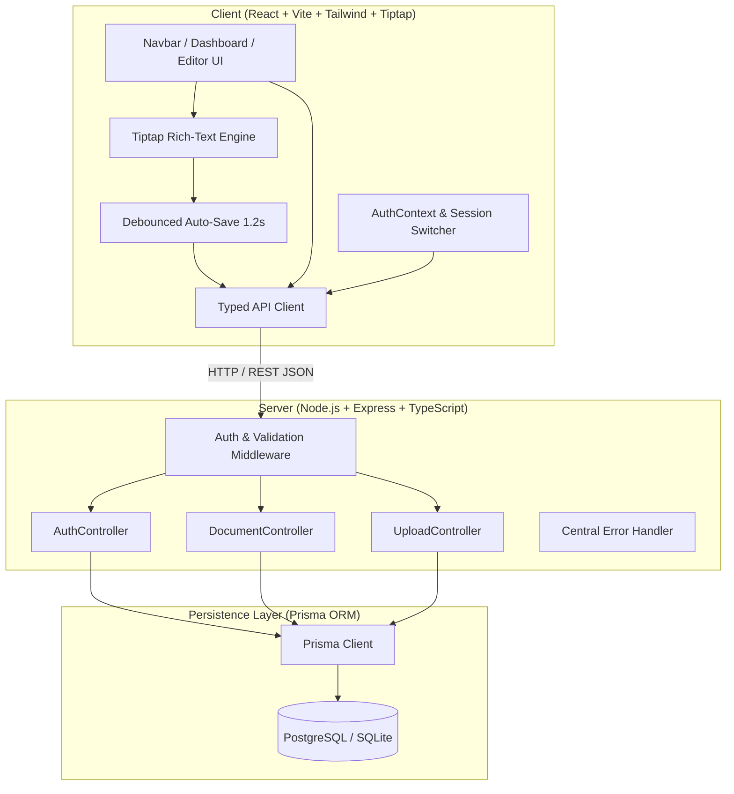
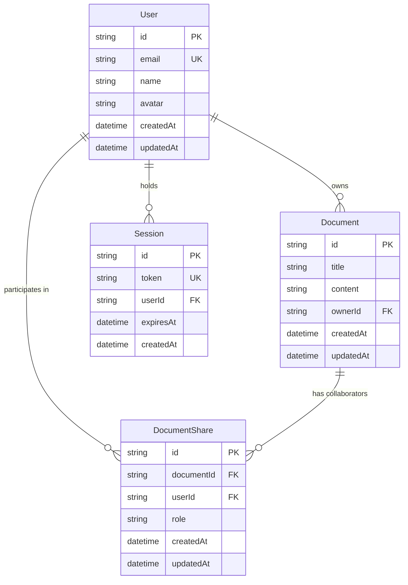

# DraftSpace — Architecture & Technical Design Note

---

## 1. System Overview

DraftSpace is architected as a clean, decoupled full-stack application structured within an npm workspace monorepo. It adheres to standard separation of concerns: a modern React Single Page Application (SPA) frontend communicating over REST with an Express TypeScript backend powered by Prisma ORM.

---

## 2. Frontend Architecture

### 2.1 Rich-Text Engine (Tiptap & ProseMirror)
- **Editor Core**: Powered by `@tiptap/react` and `@tiptap/starter-kit`.
- **Formatting Extensions**:
  - Headings (`level: [1, 2, 3]`)
  - Typography Marks: `Bold`, `Italic`, `Underline` (`@tiptap/extension-underline`)
  - Lists: `BulletList`, `OrderedList`
  - Block Elements: `Blockquote`, `CodeBlock`, `HorizontalRule`
  - Alignment: `@tiptap/extension-text-align` supporting `left`, `center`, `right`.
- **Read-Only Enforcement**: The editor accepts an `editable: boolean` prop derived from the user's role on the document. When a user has `viewer` access, `editor.setEditable(false)` disables all editing mutations, accompanied by a visual view-only banner.

### 2.2 Debounced Auto-Save Mechanism
To prevent jarring manual save requirements while avoiding server inundation on every keystroke:
1. Every editor mutation updates local React state immediately and sets `saveStatus = 'unsaved'`.
2. A debounced timer (`1200ms`) accumulates pending changes.
3. Once typing ceases, a single `PUT /api/documents/:id` request updates title and HTML content.
4. The status pill transitions from `unsaved` (amber pulse) to `saving...` (blue spinner) to `saved to cloud` (green check).
5. Manual saves via `Ctrl+S` or the "Save" button instantly clear the timer and trigger immediate synchronization.

### 2.3 Instant Persona Switcher
Rather than mock state or complex external authentication, DraftSpace uses seeded demo accounts (`alex@draftspace.dev`, `morgan@draftspace.dev`, `sam@draftspace.dev`). Switching personas requests a real server-issued session token from `POST /api/auth/login`, persists it to `localStorage`, and updates the entire application's security context.

---

## 3. Backend & Security Architecture

### 3.1 Layered Request Pipeline
1. **Routing Layer**: Express routers defining strict REST endpoints.
2. **Authentication Middleware (`authMiddleware`)**:
   - Extracts session token from `Authorization: Bearer <token>` or `x-session-token` header.
   - Validates session expiry against the database.
   - Attaches authenticated `User` record to `req.user`.
3. **Validation Layer (`validateBody`)**:
   - Zod schemas validate payload structure (e.g. non-empty title, valid enum roles `editor` | `viewer`).
4. **Controller Layer**: Encapsulates business logic, permission verification, and database interactions.
5. **Centralized Error Handling (`errorHandler`)**:
   - Translates Zod validation errors to HTTP 400 with path-level error descriptors.
   - Converts unauthorized or forbidden access to HTTP 401 and HTTP 403.
   - Sanitizes unhandled exceptions into structured JSON `{ error, code }`.

---

## 4. Permission & Access Control Matrix

DraftSpace enforces a strict 3-tier Role-Based Access Control (RBAC) model:

| Action | Document Owner | Shared Editor | Shared Viewer | Unshared User |
|--------|:--------------:|:-------------:|:-------------:|:-------------:|
| **View Document** | ✅ Yes | ✅ Yes | ✅ Yes | ❌ 403 Forbidden |
| **Edit Content** | ✅ Yes | ✅ Yes | ❌ 403 Forbidden | ❌ 403 Forbidden |
| **Rename Title** | ✅ Yes | ✅ Yes | ❌ 403 Forbidden | ❌ 403 Forbidden |
| **Grant / Revoke Access** | ✅ Yes | ❌ 403 Forbidden | ❌ 403 Forbidden | ❌ 403 Forbidden |
| **Delete Document** | ✅ Yes | ❌ 403 Forbidden | ❌ 403 Forbidden | ❌ 403 Forbidden |

---

## 5. Relational Data Model (Prisma ORM)

### Dual-Database Adapter Strategy
To ensure maximum portability and compliance with project requirements:
- **Production / Cloud Deployment**: Configured for **PostgreSQL** (`prisma/schema.prisma`). Compatible with Neon, Supabase, Render Postgres, and local Docker Postgres.
- **Local Dev & Automated Testing**: Configured for **SQLite** (`prisma/schema.sqlite.prisma`) via `server/scripts/db-setup.js`. This ensures that automated tests run with 100% reliability in any environment without requiring external database dependencies to be pre-installed.

---

## 6. Product-Relevant File Import Pipeline

Requirement 5 stipulates a product-relevant file upload. DraftSpace implements a UTF-8 `.txt` and `.md` document importer:
1. **Multipart Upload**: Handled via `multer` in memory storage (`uploadMiddleware`).
2. **File Validation**:
   - Extension check: `.txt` or `.md`.
   - Size limit: 2 MB.
   - Encoding: Decoded as UTF-8 string buffer.
3. **AST / Semantic Transformation**:
   - Derives document title from original filename (sanitized of extensions).
   - Translates markdown headings (`#`, `##`, `###`) and lists (`-`, `*`, `1.`) into semantic HTML markup.
   - Encapsulates paragraphs with `
...
`, preserving line breaks.
4. **Persistence & Ownership**: Instantiates a new `Document` entity owned by the active user and immediately navigates to it in the editor.

---

## 7. Deliberate Scope Boundaries
1. **Single-Editor Access over Operational Transformation (OT/CRDT)**: True multi-cursor collaborative editing (like Yjs or Google Docs OT) introduces substantial complexity and was explicitly excluded in assessment guidelines. Sharing grants access permissions, not simultaneous multi-cursor presence.
2. **No Threaded Comments**: Focus remained strictly on core rich-text editing, document management, and permission security.
3. **Simplified Authentication**: Seeded demo accounts provide realistic bearer session tokens while enabling frictionless evaluation without signup friction.
